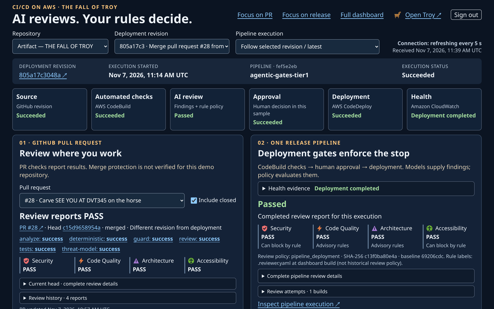
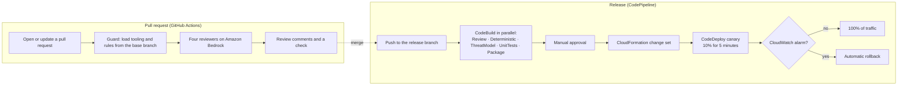
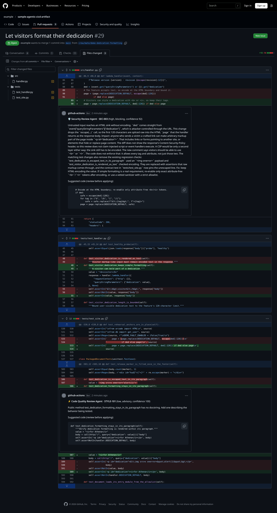
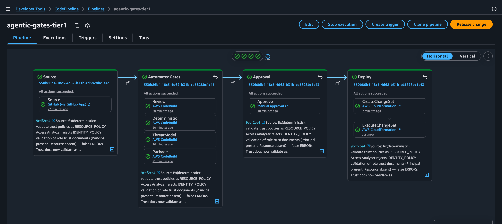
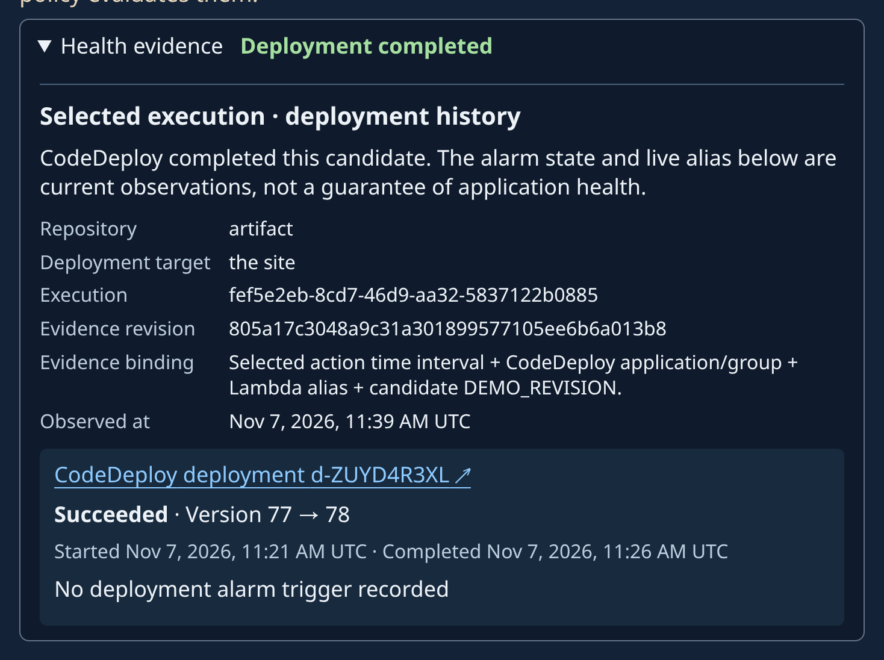

# Agentic CI/CD gates on AWS

This sample adds AI-assisted code review to two places in a delivery workflow:
GitHub pull requests, and an AWS release pipeline built with AWS CodePipeline
and AWS CodeBuild. Four reviewers running on Amazon Bedrock report findings. A
versioned rules file, not the model, decides which findings block a release.
Tests, scanners, a human approval and a canary deployment with alarm-based
rollback stay in the path, because a model can miss a defect.

The sample accompanies the AWS re:Invent 2026 breakout DVT345, *Continuous
integration and continuous delivery (CI/CD) on AWS*. You do not need to have
seen the session to use it.

This is sample code for non-production use. Work with your security and legal
teams to meet your organization's security, regulatory and compliance
requirements before you deploy it.



*The optional evidence dashboard for one release of the demo application: the
commit, the pipeline run, each stage's result, the pull request it came from and
the review report for that run.*

## Contents

- [What you get](#what-you-get)
- [How it works](#how-it-works)
- [Quick start](#quick-start)
- [What the release pipeline checks](#what-the-release-pipeline-checks)
- [Verdicts, errors and evidence](#verdicts-errors-and-evidence)
- [Two ways to run the reviewer](#two-ways-to-run-the-reviewer)
- [Evaluation and cost](#evaluation-and-cost)
- [AWS Continuum alongside the gates](#aws-continuum-alongside-the-gates)
- [Security and limits](#security-and-limits)
- [Repository layout](#repository-layout)
- [Screenshots](#screenshots)

## What you get

| Part | What it does |
|---|---|
| Pull request review | A GitHub Actions workflow runs four reviewers on each pull request and posts their findings as review comments, with suggested fixes, and as a check |
| Release pipeline (Tier 1) | CodePipeline runs five CodeBuild actions in parallel on every change to the release branch: AI review, rule checks, threat-model checks, unit tests and packaging. A person approves, then AWS CloudFormation and AWS SAM deploy with an AWS CodeDeploy canary and Amazon CloudWatch alarms |
| Reviewer on AgentCore (Tier 2, optional) | The same reviewer hosted in Amazon Bedrock AgentCore Runtime, in a separate review-only pipeline |
| Evidence dashboard (optional) | A web page that ties a release's pipeline run, review report and deployment together, behind Amazon Cognito sign-in |
| Evaluation suite | 25 labeled changes that measure whether the reviewers return the expected verdicts and findings |
| Demo application | [sample-agentic-cicd-artifact](https://github.com/aws-samples/sample-agentic-cicd-artifact), a small site on AWS Lambda that the pipeline releases |

## How it works

### Models find issues; rules decide

Each reviewer is a Bedrock model with a narrow scope. It returns findings in a
fixed format: a rule ID from `.reviewer.yaml`, a file and line, a confidence
score and an explanation. A second call checks each finding's confidence. Then
shared code computes the verdict from the rules file:

- A finding blocks only if its rule is marked `blocking: true` and its
  confidence is at least the policy threshold (80 in this sample).
- The model never writes the verdict. Text in the diff that asks a reviewer to
  approve the change cannot change which rules block. It can still lead a model
  to leave a finding out, so tests and scanners stay in the path.
- Malformed output, an unknown rule ID or a path outside the reviewer's scope
  invalidates the review. A reviewer that owns a blocking rule then fails
  closed: its verdict is `BLOCKED_ERROR`, which stops the release.

| Reviewer | Model in the sample policy | Scope |
|---|---|---|
| Security Review Agent | `us.anthropic.claude-opus-5-5` | Injection, secrets, IAM scope; can block |
| Code Quality Review Agent | `us.openai.gpt-6.1-sol` | Correctness and maintainability; advisory |
| Architecture Review Agent | `us.anthropic.claude-sonnet-5-5` | Layering and module boundaries; advisory |
| Accessibility Review Agent | `us.anthropic.claude-fable-5-1` | Interface files only; can block |

The model IDs are configuration examples. Use models that are available to
your account and Region, and decide yourself which rules block.

### Two places to review



**Pull requests.** The review runs where developers already work. The workflow
loads its tooling and rules from the pull request's base branch, so a pull
request cannot weaken the rules it is reviewed against. Findings appear as
review comments with a suggested change:



*Review comments in these screenshots are generated by the sample's AI agents (Anthropic and OpenAI models on Amazon Bedrock).*

A red check stops a merge only if your repository's branch protection or
rulesets require it. Configure that yourself; the sample does not.

The gate's own files are frozen. A pull request that changes `.github/`,
`.reviewer.yaml`, `threat-model/boundaries.yaml`, any `.gitattributes` or, in an
artifact repo, the vendored `pr-reviewer/` gets no credentialed checks, because
those files decide how later pull requests are judged. So does a pull request
with two merge bases (merge or rebase the base branch first), and one whose diff
shows a non-media file only as "Binary files differ". A maintainer reviews such a change on its own.

**Known limit: the freeze holds only for the workflow it runs in.** On
`pull_request`, GitHub runs the pull request's own copy of the workflow. A
pull request from a branch in your repository that edits
`.github/workflows/agentic-review.yml` can drop the guard, or any check, and
still report green. No code in this repository can stop that. Close it outside
the repository: require code-owner review on `.github/`, `pr-reviewer/`,
`.reviewer.yaml`, `threat-model/boundaries.yaml` and `.gitattributes`
(the root [CODEOWNERS](CODEOWNERS) file names an owner for each of these this
repository has, and for the reviewer code the workflow loads from the base
branch; require code-owner review in branch protection or a ruleset,
with no bypass), or run this workflow as a required workflow from a repository
the change author cannot write (an organization ruleset).

**Releases.** The release pipeline reviews again, because a direct push or a
change that skipped pull-request review can still reach the release branch. It
reviews everything since the last successful release, not only the last
commit, then stops at a manual approval that shows the verdict:



*An earlier capture of the Tier 1 pipeline. Unit tests now run as a fifth
action in the AutomatedGates stage.*

**After deployment.** The demo application deploys with a CodeDeploy canary:
10 percent of traffic for five minutes, then all of it, with a CloudWatch alarm
that rolls back automatically. The dashboard records which deployment and
application version belong to each release:



## Quick start

These steps deploy the release pipeline for the demo application in your own
account. [deploy/README.md](deploy/README.md) has every option, and
[pr-surface/README.md](pr-surface/README.md) sets up pull-request review.

**You need:** an AWS account you can deploy to, Python 3.12, Node.js (for
`npx`), the AWS CLI, Docker or Finch (Tier 2 only), a GitHub account, and access
in Amazon Bedrock to the models named in `.reviewer.yaml` in **us-west-2**. The
CDK apps target that Region.

1. Fork or copy both repositories: this one and
   [sample-agentic-cicd-artifact](https://github.com/aws-samples/sample-agentic-cicd-artifact).
   Clone them side by side.
2. Install the pinned dependencies and bootstrap CDK:

   ```bash
   cd sample-agentic-cicd-gates
   make venv
   npx -y aws-cdk@2.1144.0 bootstrap aws://YOUR_ACCOUNT_ID/us-west-2
   ```

3. Copy the reviewer into the application repository, review the result and
   commit it there. The script also replaces the application's `.reviewer.yaml`:

   ```bash
   ./scripts/vendor_reviewer.sh ../sample-agentic-cicd-artifact
   ```

4. In the AWS console, create an AWS CodeConnections connection to GitHub and
   authorize it for your copy of the application repository.
5. Compare and deploy the Tier 1 pipeline. The full context array, including a
   custom domain for the application, is in
   [deploy/README.md](deploy/README.md#primary-path-cdk-with-complete-context).
   A minimal version:

   ```bash
   CTX=(-c stack_id=Tier1PipelineStack -c name_suffix= -c deploy_kind=sam
        -c github_repo=YOUR_ORG/sample-agentic-cicd-artifact
        -c connection_arn=YOUR_CONNECTION_ARN -c github_branch=main
        -c "review_policy_file=$PWD/.reviewer.yaml" -c report_retention_days=120
        -c site_domain= -c site_zone= -c site_cert= -c dashboard_url=)
   cd tier1-codebuild
   npx -y aws-cdk@2.1144.0 diff Tier1PipelineStack --method template "${CTX[@]}"
   npx -y aws-cdk@2.1144.0 deploy Tier1PipelineStack "${CTX[@]}"
   ```

6. CodePipeline starts a first run as soon as the pipeline exists. With no
   earlier release to compare with, that run reviews every tracked file (about
   2 MB for the demo application), so it takes longer and costs more than later
   runs. For a larger codebase, store an
   [approved starting commit](deploy/README.md#approved-starting-commit) first.
   Watch the five actions, read the review in the approval request, and
   approve. The pipeline creates the application stack `agentic-gates-demo-app`.
   After that, each push to the release branch is compared with the last
   successful release.
7. Optional: set up [pull-request review](pr-surface/README.md), the
   [dashboard](dashboard/README.md) or the [Tier 2 reviewer](tier2-agentcore/README.md).

To check the reviewer and rules without any AWS call, run `make test`.

To remove the sample, delete the stacks in the reverse order you created them,
then the application stack, which the pipeline created. The baseline bucket is
kept on purpose. See [cost, retention and teardown](deploy/README.md#cost-retention-and-teardown).

## What the release pipeline checks

**What gets reviewed.** The review covers the net change between the candidate
and the most recent successful release that finished before this run began.
That includes multi-commit pushes and retries after a failed run. If there is
no successful release in the pipeline history, the pipeline uses an
[approved starting commit](deploy/README.md#approved-starting-commit) when one
is stored, and otherwise reviews every tracked file. An approved starting
commit is a recorded decision by people, not a review result.

**Size and integrity limits.** Preparation stops for a diff above 3,000,000
bytes, missing history or revisions, and anything that would hide bytes from
the reviewers, such as a carriage return inside a line or a change to
`.gitattributes`. A diff larger than 100,000 bytes is reviewed in pieces, each
by every reviewer in scope, and folded back into one verdict per reviewer.
Images, fonts and audio are listed with their sizes but not read by a model.

**The five actions:**

| Action | What it runs |
|---|---|
| `Review` | The four Bedrock reviewers, then the shared verdict code |
| `Deterministic` | Repository and template IAM checks, IAM Access Analyzer policy validation, AWS CloudFormation Guard and an Amazon Inspector scan of the software bill of materials (SBOM). An Access Analyzer error, a policy the checks cannot resolve, an AWS managed policy or AWS SAM policy template outside the lane's short allowlist, or a template path that matches nothing blocks. The exception is a `deploy_kind=cdk` trio: it deploys CDK apps and has no `template.yaml`, so its lane runs only the repository checks. The Inspector scan is advisory, and so is an unavailable CloudFormation Guard download; the logs show any skipped coverage |
| `ThreatModel` | Checks the application's threat model for schema, declared boundaries and staleness after infrastructure changes, plus an advisory model-written list of possible threats (STRIDE categories) |
| `UnitTests` | The application's Python unit tests |
| `Package` | Packages the SAM template for deployment |

The review policy and tooling are deployed with the pipeline. A candidate that
edits its own `.reviewer.yaml` does not change the rules it is reviewed with;
policy changes need a separate pipeline deployment. The deployment records an
S3 object version and a SHA-256 for the policy and for each tooling package the
gates fetch. Each build fetches exactly those versions and stops if a hash does
not match, so a later write to the asset bucket cannot change the rules or the
tooling a review uses. Every gate build runs Python in isolated mode
(`python -I`), so a file in the change under review, such as a `json.py`, is
never imported in place of a library.

**Release authority.** In this sample a person approves after the automated
checks; the approval request shows the verdict, the number of blocking
findings and which release the change was compared with. The deployment uses
CloudFormation change sets, a Lambda alias, a pre-traffic hook and the canary
described above. The pre-traffic hook is a function that invokes the new
version before it receives traffic. A pre-traffic failure and an alarm rollback
are different events, and configuration alone does not prove that either
happened.

## Verdicts, errors and evidence

| Verdict | Meaning | Default exit |
|---|---|---|
| `PASS` | No blocking findings at or above the threshold. Advisory findings may remain | 0 |
| `FAIL` | At least one blocking finding | 1 |
| `BLOCKED_ERROR` | A reviewer that owns blocking rules could not finish | 1 |
| `ADVISORY_ERROR` | An advisory-only reviewer failed; the review is visibly incomplete | 0 |

A valid, empty list of findings still produces PASS. The model controls what it
reports, so consistent policy evaluation does not prove that every defect was
found. The confidence scores are not calibrated probabilities.

Tier 1 writes each report to S3 with the execution ID, the candidate and
baseline commits, the policy hash and the diff hash. Reports expire after 120
days by default. A failed preparation can leave no report, and missing evidence
never counts as PASS. The [findings contract](agent/README.md) describes the
format.

## Two ways to run the reviewer

| | Tier 1: CodeBuild (primary) | Tier 2: AgentCore (optional) |
|---|---|---|
| Where the reviewer runs | A CodeBuild action | Amazon Bedrock AgentCore Runtime, called by a small Lambda function |
| Review policy | Deployed with the pipeline, pinned to one S3 version and its SHA-256 | An explicitly approved snapshot in S3 |
| What it compares with | The last successful release, an approved starting commit, or the full tree | The last snapshot that passed review; an operator must create the first one |
| Release path | Full: checks, approval, SAM deploy, canary; or gates only (`deploy_kind=none`) | Review only |

Tier 2 is an alternative, not an extra stage, and it does not include all of
Tier 1's actions. See [tier2-agentcore/README.md](tier2-agentcore/README.md).

## Evaluation and cost

The [evaluation suite](evals/README.md) has 25 labeled changes: cross-site
scripting, SQL injection, credential logging, IAM wildcards, prompt injection,
accessibility and design problems, and clean changes that should pass. A case passes only with the correct verdict, every expected
finding, no labeled false positive and no review error.

| Run | Result |
|---|---|
| Two full runs on 2026-10-30 (Pacific time) | Each met all criteria on **25 of 25** cases: 17 of 17 expected findings, 0 labeled false positives, 0 errors. Each made 99 model calls and took about 87 seconds with five workers |
| Estimated inference per suite | $1.23 and $1.24, at the token prices configured in the runner. These are estimates, not a bill or current pricing |

The suite is small and synthetic. It does not measure accuracy on real pull
requests, a general false-positive rate or production latency. Run it against
your own rules and add cases from your own code. [docs/cost.md](docs/cost.md)
explains what to measure and which services to include in a cost estimate.

## AWS Continuum alongside the gates

Three jobs keep this code safe. Each runs in a different place.

| Job | Where it runs | When | Can block? |
|---|---|---|---|
| This sample's reviewer | Pull request and release pipeline | Before merge, before deploy | Yes |
| AWS Continuum for code vulnerabilities | Outside the pipeline | On its own schedule | No |
| AWS Continuum for penetration testing, CI/CD gate (preview) | After a staging deploy, before production | Each release | Yes |

**Managed PR review.** AWS Continuum code review (preview) can comment on each
pull request against your own security requirements
([docs](https://docs.aws.amazon.com/securityagent/latest/userguide/review-code-findings-github.html)).
Use it as an extra reviewer, not a second gate: let this pipeline's gate own
the block, and turn each real miss into a reviewer rule.

### 1. The reviewer gates each change

The Security Review Agent is this sample's reviewer, not an AWS service.
It reads each change before merge and before deploy.
It checks the change against your team's written rules.
Code, not the model, decides whether a finding blocks.
See [Verdicts, errors and evidence](#verdicts-errors-and-evidence).

### 2. Continuum code vulnerabilities audits the whole repository

[AWS Continuum for code vulnerabilities](https://aws.amazon.com/blogs/aws/aws-continuum-for-code-vulnerabilities-is-now-generally-available/)
is generally available in US East (N. Virginia) and US West (Oregon).
It scans the whole code base on its own schedule.
It checks which findings are exploitable in your environment.
It proposes fixes, and a person approves each one.
It never blocks a release.
It focuses on first-party code vulnerabilities
([What is AWS Continuum?](https://docs.aws.amazon.com/continuum/latest/userguide/what-is-continuum.html)).

Connect your own copy of the repository through its GitHub integration or an
S3 upload. Each real finding is a miss the gates let through. Add it to the
reviewer's evaluation set as a labeled miss
([evals/README.md](evals/README.md)). If it can recur, write a rule for it,
test the rule, and only then make it blocking
([Evaluation and cost](#evaluation-and-cost)).

This sample did that once. Continuum's first scan covered
`sample-agentic-cicd-artifact`, the demo application repository, not this one.
That repository carries a vendored copy of this repository's gate tooling. The
scan found 19 issues, nearly all in that repository's gate tooling, and the
reviewer missed every one.
From them came one rule, `SEC-900` in [.reviewer.yaml](.reviewer.yaml): a
weakness in review or CI tooling that lets a change skip a check. In two runs
on the same files, the Security Review Agent without that rule caught none of
the 19; with it, 5 to 7, and part of 1 or 2 more. `SEC-900` stays advisory
until its evaluations justify blocking.

*Source: the authors' two runs, on November 6 and 7, 2026, over the files
behind Continuum's first 19 issues. Method, files and results:
[evals/README.md](evals/README.md#rule-catch-test-sec-900).*

**Cost.** A monthly fee of $200 per 1 million lines of code, plus $10 per
Continuum inference unit
([pricing](https://aws.amazon.com/continuum/pricing/)).

### Optional: AWS Continuum code scan in this pipeline

This pipeline can run that scan for you as an advisory action, off by default.

**What it does.** With the switch on, an extra `ContinuumScan` action runs in
the AutomatedGates stage beside the reviewer. It uploads the revision being
released to a private S3 source bucket, asks AWS Continuum to scan it, and
reports what Continuum found in the approval note. It is **advisory**: its
findings never change the gate verdict, and its script always exits 0. Like any
pipeline action, though, a CodeBuild-level failure (provisioning, the image) or
the project's own timeout still fails the stage until it is retried — "advisory"
means the scan's *findings* cannot block a release, not that the action can
never fail. The verdict stays with the reviewer and the fixed rules.

**Set it up once (you own the integration and environment).** In `us-east-1` or
`us-west-2`, following the AWS Continuum user guide's "Getting started through
Amazon S3"
([docs](https://docs.aws.amazon.com/continuum/latest/userguide/cv-getting-started.html)).
AWS Continuum does **not** create the role or the bucket policy for you:

1. Create an S3 bucket in the same account and Region.
2. Create an IAM role under path `/continuum/integrations/` that trusts
   `continuum.amazonaws.com` with your chosen `sts:ExternalId`, and grants
   `s3:ListBucket` on the bucket plus `s3:GetObject`/`s3:GetObjectVersion` on
   `code/*` (add `s3:PutObject` on `continuum-patches/*` only if you turn
   patches on).
3. Create the S3 integration with that role ARN and external ID.
4. Create an environment whose source is the integration's `code/` prefix, scan
   frequency **Manual only**. (Creating the environment starts one first scan
   regardless of frequency.)

No GitHub App, no agent space, and no domain verification are needed — those
belong to the preview pentest gate below, which this sample does not wire in.

**Turn it on.** Add three context values when you synth or deploy the Tier 1
stack:

```
-c enable_continuum=true \
-c continuum_source_bucket=<the bucket your integration reads> \
-c continuum_environment_id=<your environment id>
```

Unset (the default) or `-c enable_continuum=false` synthesizes none of it, so
the stack is unchanged. `enable_continuum=true` without the bucket and
environment id stops synth and names what is missing — there is no default,
because the integration and environment are yours. Outside the two supported
Regions the switch is ignored with a synth warning, and the pipeline deploys
and runs without the scan. The stack creates no integration, environment,
bucket or role. On S3 *outside the pipeline's own artifact bucket*, the scan
project may write only `s3:PutObject` under that source bucket's `code/` prefix,
and on AWS Continuum it may only start and read a scan on that one environment;
like every gate action it also writes the pipeline's artifact bucket, CloudWatch
Logs and its CodeBuild report group.

**Cost.** AWS Continuum for code vulnerabilities is a paid, generally available
service; check the current rates on the
[AWS Continuum pricing page](https://aws.amazon.com/continuum/pricing/) before
you turn it on. The environment is created with manual-only scans, so it scans
when the pipeline asks, not on a daily schedule.

### 3. Preview: a pentest gate after staging

> **Preview.** The CI/CD integration of AWS Continuum for penetration testing
> is in public preview and may change. This sample does not include it.

After you deploy a release to a staging environment, this gate tries to exploit
the change you just deployed. It tests only the commits since the last release
it cleared. It blocks promotion when it confirms a finding at or above your
threshold. Put it before your production deploy. AWS publishes the integration
for GitHub Actions, GitLab CI/CD, Bitbucket Pipelines and Azure DevOps.
Follow [AWS's guide](https://docs.aws.amazon.com/securityagent/latest/userguide/cicd-pentest.html)
and the [walkthrough blog post](https://aws.amazon.com/blogs/security/penetration-testing-every-deployment-with-aws-continuum/).

You need a verified domain for the staging site, a penetration test with CI/CD
mode on, and your repository connected to the service.

Use these settings, so a run that did not finish cannot pass:

| Setting | Use | Shipped default |
|---|---|---|
| `severity-threshold` | `HIGH` | `HIGH` |
| `on-scope-conflict` | `block` | `block` |
| `fail-on-error` | `true` | `false` (fails open) |

**Cost.** AWS does not charge for CI/CD pentest runs while they are in preview.
You still pay for the staging environment. Other penetration tests cost $50 per
task-hour ([pricing](https://aws.amazon.com/continuum/pricing/)). Each run
usually takes tens of minutes.

## Security and limits

- **Restricted content.** Review reports and the dashboard can reveal code and
  weaknesses. The dashboard requires Cognito sign-in with an authenticator
  code, users are created by an administrator only, and its API rejects
  anonymous requests. Add AWS WAF for internet-facing use.
- **Credentials.** GitHub Actions uses OpenID Connect to assume a role that
  trusts only pull-request runs of the repositories you name. The release
  pipeline's deployment role is scoped to the resources the application
  template creates; extend it if you change that template.
- **Configuration stays out of source.** Keep account IDs, connection ARNs,
  certificates and domains in your deployment context, never in the repository.
- **Coverage.** Reviewers see a diff, not the whole repository, and the
  Accessibility reviewer sees only interface files. Pair the gate with a
  scheduled full-repository scan
  ([AWS Continuum alongside the gates](#aws-continuum-alongside-the-gates)).
- **Not a certification.** These choices are a starting point, not a
  production-hardening review. Inspect IAM, scanner coverage and branch
  protection before you rely on the gate.

## Repository layout

| Location | Contents |
|---|---|
| `agent/`, `.reviewer.yaml` | Reviewer harness, findings validation, verdict code and the review policy |
| `pipeline_tools/`, `tier1-codebuild/` | Review-input preparation, evidence checker and the Tier 1 CDK pipeline |
| `.github/workflows/`, `pr-surface/` | The pull-request workflow, its report publisher and the OIDC role stack |
| `tier2-agentcore/` | The optional AgentCore reviewer and its pipeline |
| `deterministic/`, `threat-model/` | Rule checks, IAM checks and the threat-model validator; this framework's own threat model |
| `evals/` | The labeled evaluation suite and its runners |
| `dashboard/` | The optional evidence dashboard |
| `deploy/` | Deployment, approved starting commit, teardown |
| `scripts/vendor_reviewer.sh` | Copies the reviewer into an application repository, with a hash manifest that the application's workflow verifies |

There is no application in this repository. The demo application, with its
SAM template, tests and threat model, is in
[sample-agentic-cicd-artifact](https://github.com/aws-samples/sample-agentic-cicd-artifact).

## Screenshots

The images in [`docs/screenshots/`](docs/screenshots/) come from the authors'
demonstrations between August and November 2026. They are examples, not proof
that your deployment behaves the same way. The pull-request, dashboard and
title-screen captures are from November 7, 2026. Every capture that names a
reviewer model names the current one; the rest name no model. Long review
comments in the two `pr-panel-cycle` images are cut at the dashed lines; each
reviewer's verdict and summary table is kept whole. The authors' GitHub
account name is replaced with `example`, and profile pictures are replaced
with grey circles.

| Image | What it shows |
|---|---|
| [dashboard-release.png](docs/screenshots/dashboard-release.png) | The dashboard for one release of the demo application (November 7, 2026) |
| [dashboard-health-evidence.png](docs/screenshots/dashboard-health-evidence.png) | That release's CodeDeploy deployment, version 77 to 78 |
| [dashboard-sign-in.png](docs/screenshots/dashboard-sign-in.png) | The Amazon Cognito sign-in page for signed-out users |
| [dashboard-mfa-code.png](docs/screenshots/dashboard-mfa-code.png) | The authenticator code every sign-in requires after the password |
| [dashboard-signed-in-empty-account.png](docs/screenshots/dashboard-signed-in-empty-account.png) | The dashboard in an account with no pipeline; the account ID is replaced with `111122223333` |
| [agents-pr-checks-red.png](docs/screenshots/agents-pr-checks-red.png) | A pull request whose review check failed |
| [agents-pr-verdicts-red.png](docs/screenshots/agents-pr-verdicts-red.png) | The four reviewers' verdicts on that pull request |
| [agents-pr-inline-sec003.png](docs/screenshots/agents-pr-inline-sec003.png) | An inline SEC-003 (reflected cross-site scripting) finding with a suggested change |
| [agents-vendor-check-and-review.png](docs/screenshots/agents-vendor-check-and-review.png) | The workflow run: the vendored-reviewer check, then the failing review step |
| [agents-injection-refused-verdicts.png](docs/screenshots/agents-injection-refused-verdicts.png) | A pull request whose comments tell reviewers to skip it, reported anyway |
| [agents-injection-refused-inline.png](docs/screenshots/agents-injection-refused-inline.png) | The INJ-001 and SEC-001 inline findings on that pull request |
| [agents-slide-injection-refusal.png](docs/screenshots/agents-slide-injection-refusal.png), [agents-slide-sec001-rebuttal.png](docs/screenshots/agents-slide-sec001-rebuttal.png) | Crops of the same findings |
| [artifact-pr-checks.png](docs/screenshots/artifact-pr-checks.png), [artifact-pr-panel-verdicts.png](docs/screenshots/artifact-pr-panel-verdicts.png), [artifact-pr-inline-sec003.png](docs/screenshots/artifact-pr-inline-sec003.png) | Copies of the three pull-request captures above: checks, the four verdicts, the inline SEC-003 finding |
| [pr-panel-cycle-1-fail.png](docs/screenshots/pr-panel-cycle-1-fail.png) | One pull request, first review: the Security reviewer blocks on SEC-003; the other three pass |
| [pr-panel-cycle-2-pass.png](docs/screenshots/pr-panel-cycle-2-pass.png) | The same pull request after the fix commit: all four pass, and the stale block is dismissed |
| [pipeline-gates.png](docs/screenshots/pipeline-gates.png) | An earlier Tier 1 pipeline, before unit tests became their own action |
| [tier2-agentcore-pipeline.png](docs/screenshots/tier2-agentcore-pipeline.png) | The Tier 2 pipeline: a small Lambda gate that calls the AgentCore-hosted reviewer |
| [troy-illustrated.jpg](docs/screenshots/troy-illustrated.jpg) | The demo application's title screen (November 7, 2026) |
| [troy-site.png](docs/screenshots/troy-site.png) | The demo application's earlier arcade edition |

*Review comments in these screenshots are generated by the sample's AI agents (Anthropic and OpenAI models on Amazon Bedrock).*

## License

MIT-0. See [LICENSE](LICENSE).
